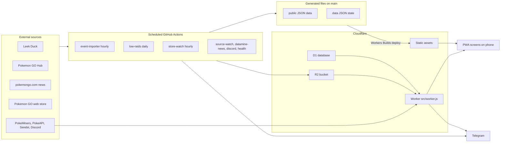
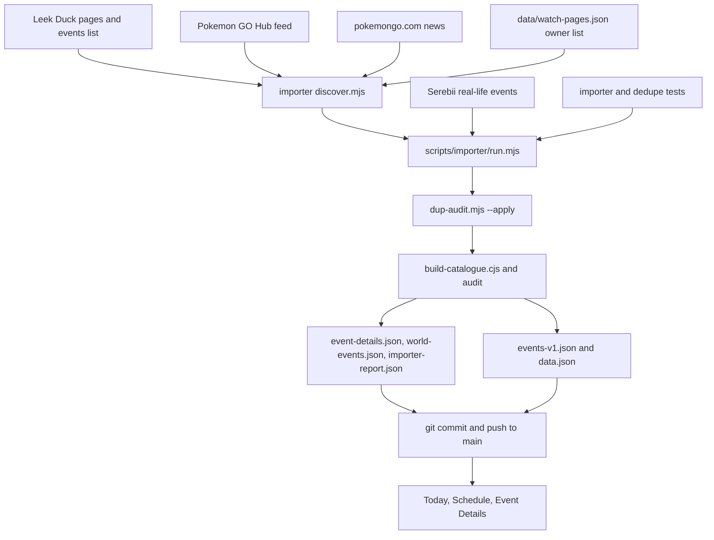
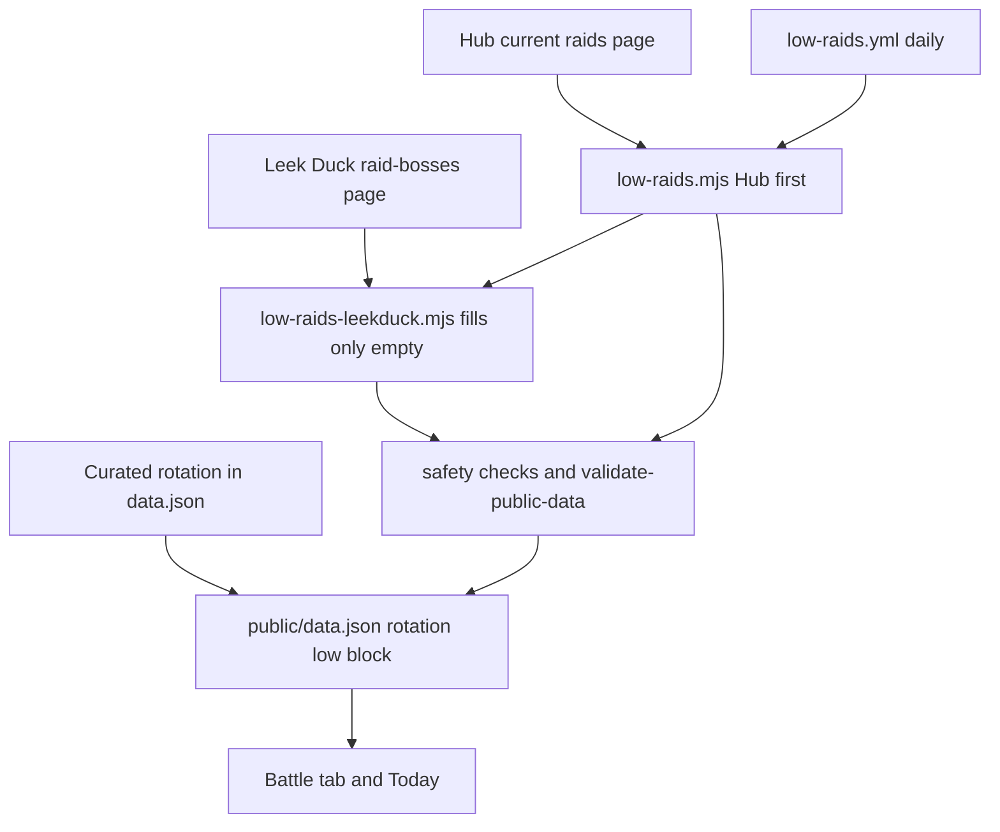
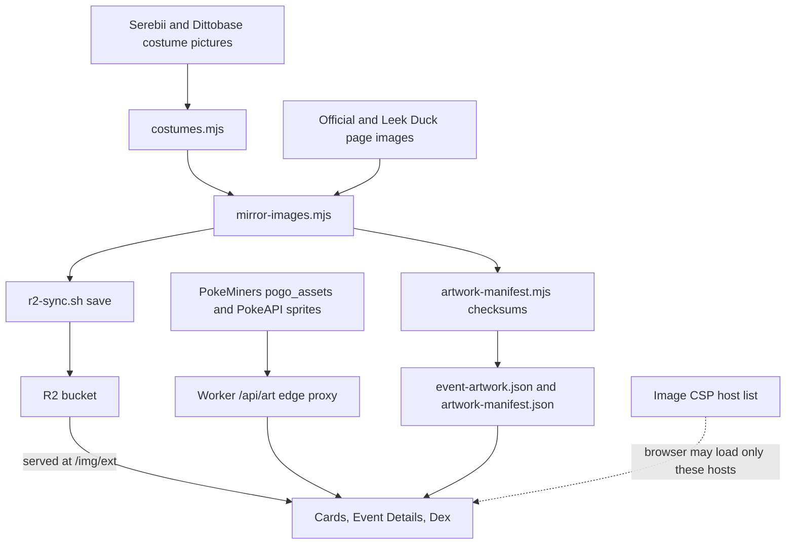
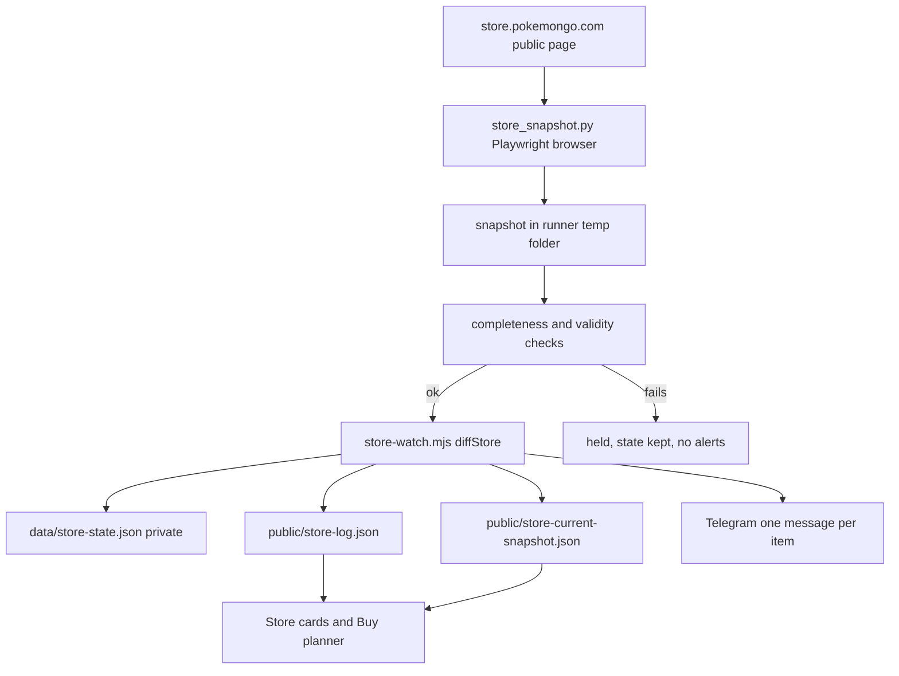
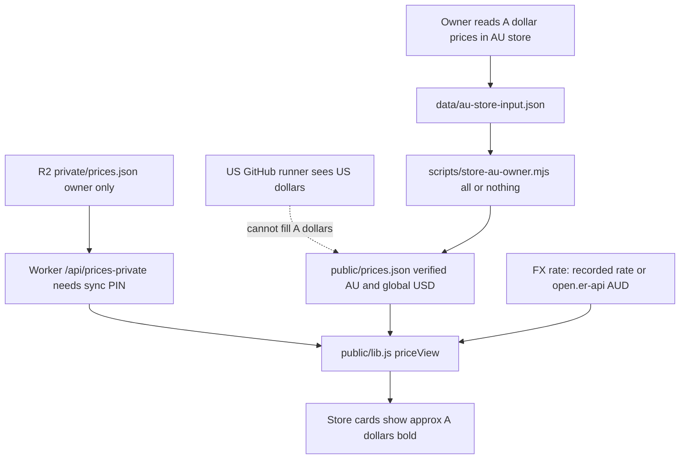
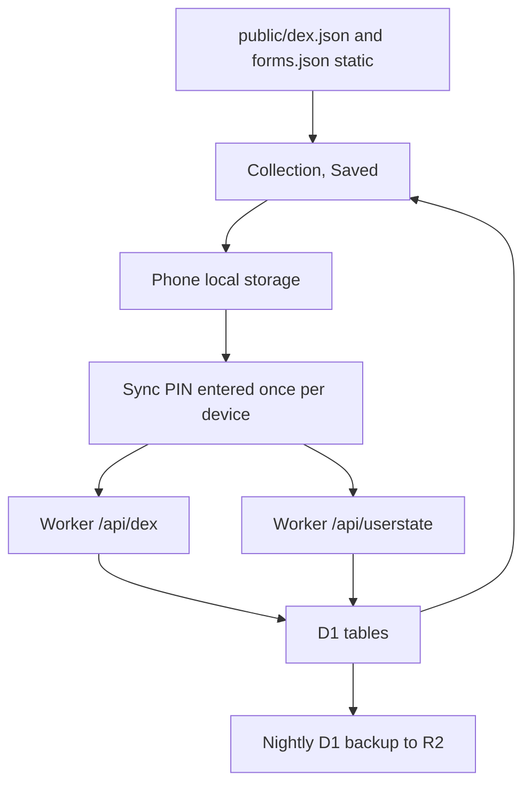

# How data gets into GO Field Notes

> Written 16 November 2026 from the code and workflows on `main` at `67d3082`. Every claim cites the file it came from. It describes what the repository is configured to do; it does **not** claim anything was observed running in production or on a phone. Check [GitHub Actions](https://github.com/Wood468/crispy-barnacle/actions) for what actually ran.
>
> Audience: the owner (non-technical). Section (e) is a list of **suggestions, not decisions**.

## (a) The short version

The app is a set of static web pages plus a small Cloudflare Worker. It has no database of events of its own that you type into. Instead, a fleet of scheduled GitHub Actions jobs (small robots that wake up on a timer) read public websites such as Leek Duck, Pokémon GO Hub, the official pokemongo.com news and the Pokémon GO web store. Each robot checks what it found, and only if the result looks sane does it save a fresh JSON file into the repository on `main`. Cloudflare then publishes `main` automatically, so the phone app simply downloads those JSON files. Pictures from other sites are copied into Cloudflare R2 storage so they keep working. Your private things (your marks, regional prices, places) never sit in the public files: they live in D1 or R2 and are only handed out to someone who sends your sync PIN. Telegram is the "tell the owner" channel for new events, store changes and health problems. The main rule running through all of it: **if a source looks broken, keep the last good data instead of publishing something worse.**

## Top-level picture

Sources: `.github/workflows/*.yml`, `wrangler.toml` (assets, D1 `DB`, R2 `MEDIA`, one hourly cron), `README.md` ("deployed by Workers Builds on every push to `main`").

What the Cloudflare boxes do (`wrangler.toml`, `src/worker.js`):

- **Static assets**: everything in `public/` is served as plain files; only `/api/*` runs the Worker first (`run_worker_first = ["/api/*"]`).
- **Worker**: live API routes such as `/api/events`, `/api/art`, `/api/dex`, `/api/userstate`, `/api/prices-private`, `/api/world`, plus the hourly cron.
- **D1** (`go-field-notes`): your Own/Hundo marks and synced state, accounts, notification tables. Migrations are in `migrations/` and generated into `src/migrations.js`.
- **R2** (`go-field-notes-images`): copied pictures and infographics (served at `/img/ext/*` and `/infographics/*` by `mediaFromR2` in `src/worker.js`), D1 backups, and owner-only private files under `private/`.
- Preview deployments deliberately have **no** R2 binding, so a preview cannot touch private prices/places or backups (`wrangler.toml` comment).

---

## (b) One section per data type

Legend used in each table: **Source** where facts come from; **Trigger** what starts it; **Script** the code; **Output** the file(s); **UI reads** which screen uses it; **Failure behaviour** what happens when it breaks; **Owner steps** anything only you can do.

### 1. Events

| Item | Detail |
| --- | --- |
| Source | Three ranked sources in `scripts/importer/sources.mjs`: **official** pokemongo.com (trust "official"), **Leek Duck** and **Pokémon GO Hub** (trust "community"). Serebii is read separately for real-life events (`run.mjs`, `SEREBII`). Leek Duck's machine-readable list (via ScrapedDuck) also feeds the Worker's `/api/events` (`src/pipeline.js`, `src/worker.js` `eventsGet`), which the importer reads as its starting list (`appEvents()` in `run.mjs`). |
| Discovery | `scripts/importer/discover.mjs` reads each source's list page or feed, keeps links matching the source's URL pattern and event keywords. Pages you want always read (multi-city tours etc.) go in `data/watch-pages.json`; they are read before the capped feed results. |
| Trigger | `event-importer.yml`: hourly at :52 UTC, manual, and on push to `main` when importer code, event-contract files, `data/watch-pages.json` or the workflow itself changes. Generated data files are deliberately **not** triggers, so it cannot loop. |
| Script order | restore pictures from R2 → run importer tests → `scripts/importer/run.mjs` → `scripts/dup-audit.mjs --apply` (join events listed twice) → re-run tests plus research/form propagation tests → Telegram "new event" note (`event-news.mjs`) → `event-moves.mjs` → `costumes.mjs` → `schedule-audit.mjs` → `mirror-images.mjs` + R2 save → artwork-manifest checksums → `build-catalogue.cjs` + `audit-catalogue-v1.cjs` → commit. |
| Output | `public/event-details.json`, `public/world-events.json`, `public/event-artwork.json`, `data/importer-report.json`, `data/importer-lines.json`, `public/events-v1.json`, `public/data.json` (curated file the importer also touches via the catalogue/mirror steps), plus audit state in `data/`. Exact `git add` list is in `event-importer.yml` ("Commit when something changed"). |
| UI reads | Today, Schedule (Calendar/Timeline/In person), Event Details: `public/detail.js`, `public/event-registry.js` (`/events-v1.json`), `public/dash.js` (`/world-events.json`, `/api/events`), `public/event-adapter.js`. |
| Failure behaviour | A failing source is reported in `importer-report.json` and skipped, never fatal. If any test or validation gate fails, **nothing is committed** and the rejected candidate files are kept as a 3-day workflow artifact for diagnosis (`Retain rejected source regeneration` step). A run with only a new "updated" stamp commits as `[skip ci]` instead of causing a deploy. |
| Owner steps | Add/remove long-running events in `data/watch-pages.json` (its own `how_to_use` note says to remove entries when the event is over). Otherwise none. |

**Retention rules for research and ended events** (the part that most affects what you see; `scripts/importer/run.mjs`, comment above `RETENTION_CONFIRM_DAYS`):

1. If this run finds no research and the source was **not fetched, incomplete or truncated**, the published research is **retained** (unknown is not "removed").
2. If the page was fully read but the parser recognised nothing (`none`), research is also retained on first sight and stamped `researchRetainedAt`; it is dropped only after the "none" has persisted **7 days** (`RETENTION_CONFIRM_DAYS`).
3. **Explicit denial removes immediately**: a fully read, non-truncated page that is the event's own page and says "No Timed Research ..." (`researchParse.explicitNone`), provided every other source is healthy or also denying (#826, #830, #831).
4. **Ended events keep their published research** when sources merely vanish (`event-ended-kept`), so a past event's page stays complete (#835). Positive removal evidence still drops it.
5. Every decision is written to `researchRetention` in `data/importer-report.json` with a reason (`unfetched`, `incomplete`, `none-unconfirmed`, `source-denies`, `removal-confirmed`, `source-ok-removed`, `event-ended-kept`, `window-mismatch`, `name-mismatch`).

### 2. Research tasks

| Item | Detail |
| --- | --- |
| Source | The same event write-ups as above; tasks are parsed by `scripts/importer/extract.mjs` (`extractFields`, `researchOptions`) and merged across sources by `compare.mjs`. |
| Trigger / script | Part of `event-importer.yml` → `run.mjs`. Regression tests: `test/research-event-propagation.test.mjs`, `test/into-wild-form-identity.test.mjs`. |
| Output | `fields.research` inside each record of `public/event-details.json`; diagnostics in `data/importer-report.json`. |
| UI reads | Schedule → Research (`public/research.js`), Event Details. |
| Failure behaviour | See the retention rules above: unknown never deletes; explicit denial deletes. A task needs an explicit source URL to be eligible for retention. |
| Owner steps | None. If a source page changes layout, expect "retained" warnings in the report rather than data loss. |

### 3. Raids and Max Battles

| Item | Detail |
| --- | --- |
| Source | 5-star and Mega rotations and Max Battle rosters are **hand-curated** in `public/data.json` (`rotation`, `maxBattles`, `maxRosters`); `README.md` says edit the file and run `scripts/event-experience/build-catalogue.cjs`. The 1-3 star and Shadow tiers are filled by robot: Pokémon GO Hub "Current GO raids" (`scripts/low-raids.mjs`, `SOURCE_URL`) then Leek Duck's raid-bosses page (`scripts/low-raids-leekduck.mjs`). |
| Matching | A page is matched to a rotation by its **5-star boss** (set equality for Leek Duck), never by the dates it prints, because Hub's date line can be out of date (header comments of both scripts). |
| Trigger | `low-raids.yml`: daily 02:30 UTC (about 1:30 pm Melbourne), manual. Rotations usually change Wednesday 10 am Melbourne but some start earlier (workflow comment). |
| Safety | Writes only when the page parses into sensible lists **and** matches a rotation; only replaces a `low` block that is empty or that the robot wrote itself; Leek Duck only **fills empty** blocks and reports conflicts instead of overwriting; the edit is made as text and a check proves nothing else in `data.json` changed. If Hub fails, a Telegram System message is sent and Leek Duck may still fill the rotation (#836, #837). |
| Output | `low` block per rotation in `public/data.json`; commit "Raid rotation: 1-3 star bosses from Pokémon GO Hub". |
| UI reads | Battle tab and Today (`public/app.js` loads `/data.json`). |
| Owner steps | Curated 5-star/Max rotation entries still need a person (or Claude) PR. |

### 4. Moves and event-moves

| Item | Detail |
| --- | --- |
| Source | Text already collected by the importer (event notes and compared details). `scripts/event-moves.mjs` finds limited-time moves such as "Pokémon caught during the event will know X". |
| Trigger | A step in `event-importer.yml`. |
| Output | `public/event-moves.json`. Event-only moves are **not** added to a Pokémon's normal moveset; the app shows them only while the window is open (script header). |
| UI reads | `public/detail.js`, `public/season.js` (both fetch `event-moves.json`). Regular movesets: `public/moves.json` read by `public/move.js`. |
| Failure behaviour | A step failure fails the importer run (no commit). |
| Owner steps | None. |

### 5. Images and artwork

| Item | Detail |
| --- | --- |
| Costume pictures | `scripts/costumes.mjs` finds a picture for each costume Pokémon named in event data (Serebii form pages, Dittobase) and checks each address exists before saving → `public/costumes.json`. |
| Mirroring | `scripts/mirror-images.mjs` copies every remote picture referenced in `costumes.json`, `season.json`, `account.js`, `dash.js`, `event-info.json`, `data.json`, `world-events.json` into `public/img/ext/` and rewrites the reference to the copy; if a download fails the original address is kept. `public/img/ext/` and `public/infographics/` are git-ignored (`.gitignore`): pictures live in **R2**. |
| R2 sync | `scripts/r2-sync.sh restore` at the start of the importer, `save` after mirroring (folders: infographics, `img/ext`, `tg-inbox`, `archive`). With no Cloudflare token (forks, local) it does nothing and succeeds; a failed `save` fails the job. |
| Manifest + checksums | `scripts/artwork-manifest.mjs` writes `public/artwork-manifest.json` (exact-variant art contract; items need an approved asset or are labelled legacy). The importer runs it **after** mirroring to record checksums of newly mirrored pictures (#838); the step is `continue-on-error`, so a failure shows an annotation but does not block the data commit. `--check` mode runs in `tests.yml` ("Check the artwork manifest ... are current"). |
| `/api/art` | `src/worker.js` `art()` fetches Pokémon artwork from PokeAPI sprites and PokeMiners `pogo_assets` (costume/Dynamax/shadow variants), cached at Cloudflare's edge. Policy: exact variant art only; a missing costume shows the ordinary species picture with a visible badge, never another costume (`artwork-manifest.mjs` `POLICY`). |
| `event-artwork.json` | Page-level banner index written by the importer (`ARTWORK_OUT` in `run.mjs`) from official/Leek Duck og:image; `build-catalogue.cjs` `inheritArtwork` shares a verified banner between records that cite the same page. Only hosts in `OG_IMAGE_HOSTS` count (`src/image-policy.js`). |
| Image CSP hosts | `img-src` in `SECURITY_HEADERS` (`src/worker.js`) is `'self' data: blob:` plus `IMAGE_CSP_HOSTS` in `src/image-policy.js`: Pokémon Showdown sprites, Bulbagarden archives, Pokébattler, `leekduck.com`, `cdn.leekduck.com`, `lh3.googleusercontent.com`, `storage.googleapis.com`, and `assets.pgo.webstore.nianticlabs.com` (Store item images; owner-approved 15 Nov 2026, Store cards only, exact host; #833). `scripts/validate-public-data.mjs` imports the list, so adding a host is a deliberate, reviewed code change. |
| UI reads | Everywhere: `public/app.js` (`/art/index.json`, `/artwork-manifest.json`, `/costumes.json`), `public/variant-art.js`, `public/event-art.js`. Service worker caches images (see section 12). |
| Failure behaviour | Missing exact art is shown as the species picture with a badge; images never fall back to a different form. |
| Owner steps | Approve any **new image host** (CSP) or new publisher artwork; approved assets in the artwork queue (`docs/asset-inventory/`). |

### 6. Store (web store watch)

| Item | Detail |
| --- | --- |
| Source | The public Pokémon GO web store, read without signing in by a headless Chromium (`scripts/store_snapshot.py`). It scrolls until two consecutive passes add nothing (`STABLE_NEEDED = 2`, max 20 passes) and records per-section card counts as "completeness evidence". |
| Trigger | `store-watch.yml`: hourly at :15 UTC, manual (default `dry_run=true` for manual runs; a dry run does not save state). |
| Script order | install Playwright → price-safeguard tests → catalogue audit → `store_snapshot.py` → `store-au-prices.mjs` → `regional-price-review.mjs` (`|| true`, never fails the run) → `store-watch.mjs` (diff + Telegram) → `store-artwork-coverage.mjs` (report only, `continue-on-error`) → "Remember what was seen": stamp heartbeat, `git add` state/log/snapshot/prices, validate, commit, rebase, push. |
| Output | `data/store-state.json` (private working state), `public/store-log.json` and `public/store-current-snapshot.json` (public), `public/prices.json` (public, see section 7). |
| UI reads | `public/store.js` (`/store-current-snapshot.json`), `public/buy.js` (`/store-log.json`, `/tickets-external.json`). |
| Telegram | One message per new item or price change with picture and "Open store" button, routed to the "changes" topic (`src/tgroute.js`). A whole-store currency flip is reported once, not as dozens of price changes; after 72 hours the new currency becomes the baseline (`CURRENCY_HOLD_MS`). |
| Safeguards (all in `scripts/store-watch.mjs`) | Snapshots are **held** (state kept, no alerts, no "gone" items) when: fewer than 3 items or malformed rows (`empty-or-short-snapshot`); mixed currencies; currency flip; **incomplete evidence** (`deriveCompleteness`: producer, stable passes, card count and per-section counts must agree); **large drop** (`large-drop`: many items missing at once, `LARGE_DROP_MIN`); items missing but not yet corroborated by a second reading (`awaiting-corroboration`, `pendingGone`). A page that shows no currency is accepted (missing price is not invalid; #824). |
| Heartbeat | `--stamp-publication` writes `lastPublishedAt` into the private state **only** for a fresh (under 30 minutes), complete observation, immediately before the commit, so it persists only if the push to `main` succeeds. It proves publication to `main`, **not** Cloudflare deployment (`stampPublication` comment). Held/invalid/incomplete runs never advance it. |
| Commit rule | A change in items or prices commits as "Store watch: the store changed" (triggers deploy). A new "checked" time alone commits as `[skip ci]`. |
| Owner steps | See Prices for A$ steps. Approve any large-drop hold if you know the store really emptied (there is currently no one-click path; see (e)). |

### 7. Prices

| Item | Detail |
| --- | --- |
| Public prices | `public/prices.json`: verified Australian (`region AU`, `AUD`, `verified:true`) and some global USD prices from published posts. Public by design. |
| Why the CI runner cannot supply A$ | The hourly watch runs on a US GitHub runner and sees US$ prices (`docs/store-au-owner-prices.md`; `store-watch.mjs` also notes the store changes display currency by request geography). `scripts/store-au-prices.mjs` therefore accepts only a **complete, all-`A$`** snapshot, otherwise changes nothing, and never replaces a price newer than its own snapshot. |
| Owner-supplied A$ | You read prices in the Australian Web Store, put them in `data/au-store-input.json`, run `node scripts/store-au-owner.mjs` (not run on CI) and commit `public/prices.json` in a PR (#832). Checks, all-or-nothing: explicit `A$x.xx` between A$0.50 and A$500; label must exactly match a current offer or an existing AU entry; `observed` a real date, not future, at most 14 days old; a price more than 3x different from the last verified one needs `"confirm": true`. Full rules: `docs/store-au-owner-prices.md`. |
| Private regional prices | Other-region (e.g. Indonesian) observations and tiers live in a private file in R2 (`private/prices.json`, read by `privateFile()` in `src/worker.js`) and are returned only by `GET /api/prices-private`, which needs your sync PIN header and sends `cache-control: private, no-store`. Not in `public/`, not in git. Previews have no R2 binding so they return empty data. `public/lib.js` fetches the route only when the device has the PIN. |
| FX / "≈A$" | The Store shows a converted **≈A$** figure as the bold price with local currency secondary (#840). Rate sources: a recorded rate in the private prices file, and the browser's fixed GET to `https://open.er-api.com/v6/latest/AUD` (`public/store-fx.js`; the only cross-origin `connect-src` in the CSP; rates older than 8 days are refused; no product data is sent). FX is display only: it never changes observed local prices or picks the "cheapest" offer (header of `store-fx.js`). |
| UI reads | `public/store.js`, `public/buy.js`, `public/regional-prices.js`, `public/lib.js`. |
| Failure behaviour | Anything unverifiable is shown as an estimate with its basis, never as a checkout price (`regional-prices.js` header). A stale FX rate adds a visible note ("more than 3 days old", `lib.js`). |
| Owner steps | Periodically read AU prices and run the owner script (Sections (d) and (e) note the manual dependency). |

### 8. Pokédex, Collection and your synced state

| Item | Detail |
| --- | --- |
| Static species data | `public/dex.json`, `public/forms.json` and `public/art/` are files in the repo and are served as static assets; no scheduled job in `.github/workflows/` rewrites them, so changes arrive through PRs. |
| Your marks | Own/Hundo marks: `GET|PUT /api/dex`, stored in D1, gated by the `SYNC_PIN` secret (`README.md` setup step; `src/worker.js` comment). Without the secret the app still works with marks kept on that device only. |
| Synced state | `src/userstate.js`: one row per entry (keys like `form:`, `saved:`, `follow:`, `pref:`, `goal:`, `hide:`, `mega:`); newest timestamp wins per entry so phone and laptop do not overwrite each other wholesale; limits of 5000 entries and 500 per request. `public/dash.js` calls `/api/userstate`. |
| Safety | If `SYNC_PIN` or the DB binding is missing the routes return "Not switched on" (404) and never match an unset PIN (`src/worker.js`). D1 backups run in the nightly Worker cron (`runBackup`). Preview deployments use a separate staging DB. |
| Owner steps | Set `SYNC_PIN` once in Cloudflare; enter it once per device. Collection work (#598) is parked, see `docs/ACTIVE_SPRINT.md`. |

### 9. Season and GO Pass

| Item | Detail |
| --- | --- |
| Source | Season/GO Pass banners and milestones in `public/season.json` are curated through PRs (its URLs point to Leek Duck pages); the importer only rewrites its picture links via `mirror-images.mjs`. Per-pass rank rewards are parsed from Leek Duck pages by `scripts/importer/gopass.mjs` into `event-details.json`. |
| Safety | If GO Pass parsing fails, previously published rank rewards are **retained** and a `goPassParseWarning` is set (`run.mjs`, "GO Pass source parsing failed; previously published rank rewards were retained"). |
| Thumbnails | `qa10-thumbnail-generation.yml` (daily and on `season.*` pushes) is read-only. |
| UI reads | `public/season.js` (banners above "For you", loads `season.json` and `event-moves.json`), GO Pass screens. |
| Owner steps | GO Pass PRs #612/#613 wait until after release (see `docs/ACTIVE_SPRINT.md`). |

### 10. Telegram notifications and other alerts

| Item | Detail |
| --- | --- |
| Routing | `src/tgroute.js`: categories `events`, `pictures`, `changes`, `datamine`, `datamine_live`, `system` each go to a Topic in your group if configured, otherwise to your single chat. Quiet hours (default 22:00-07:00 Melbourne; Pictures never quiet) deliver silently, not suppressed. |
| From GitHub Actions | New events (`event-news.mjs`), date mismatches (`schedule-audit.mjs`), store changes (`store-watch.mjs`), raid job failures (`low-raids.mjs`), site down/up (`uptime.mjs`), stale/failing jobs (`health.mjs`), weekly data report, daily nudge (`nudge.mjs`). |
| From the Worker | Hourly: saved-event reminders, Discord pictures, "starting soon", "last chance", and a **watchdog** that tells you if GitHub's scheduled jobs have stopped (`src/jobs.js` `runHourly`, `runWatchdog`). Nightly (20:30 UTC hour): datamine, D1 backup, and, only if the `PIPELINE` / `NOTIFY` variables are `"1"`, the source pipeline and PWA/Telegram notifications (`scheduled()` in `src/worker.js`). Whether those two variables are switched on in production cannot be seen from the repo. |
| Rules | Only **announced** events (official or community reported, not in conflict, with a known start) can trigger alerts; datamined or conflicting info is never urgent (`src/notify.js` header). |
| Buttons | Approve/Reject on infographics arrive at `/api/telegram/hook`, only from your chat and only with the shared handshake secret (`src/telegram.js`). |
| Failure behaviour | Telegram steps in the importer are `continue-on-error` or print what they would send when no token is present. |
| Owner steps | Decide the deferred notification-topic/push question (#452, see `docs/ACTIVE_SPRINT.md`). |

### 11. Other scheduled feeds (short)

| Job | What it does (from script header) | Output |
| --- | --- | --- |
| `source-watch.yml` + `scripts/source-watch.mjs` | Reads feeds in `data/source-feeds.json` for shiny/costume/form news. **Never changes public data.** | `data/source-watch.json` |
| `datamine-news.yml` + `datamine-news.mjs` | Reads PokeMiners update channels from Discord; community datamining only. | `public/datamine-news.json` |
| `discord_sync.yml` | Mirrors the latest community infographic from Discord. | `infographics.json`, R2 pictures |
| `g47ix-infographics.yml` | Discovers infographic posts, matches them to events, publishes pictures you approved in the app, and queues unsure ones for your review. | `data/g47ix-infographics-review.json`, `public/infographic-queue.json`, `public/event-info.json`, R2 pictures |
| `location-discovery.yml` | Finds community-reported play locations; writes only when event, coordinates and source permalink are all present. | `public/places.json` |
| `best-by-type.yml` | Weekly top attackers per type from PvPoke + PokeMiners game masters. | `public/best-by-type.json` |
| `weekly-checks.yml` | Weekly link check and announcement archive. | R2 `archive/` |

### 12. Service worker, offline caching and the asset-version rule

| Item | Detail |
| --- | --- |
| What it caches | `public/sw.js` pre-caches an app shell list (`SHELL_URLS`: pages, versioned JS/CSS, and the main JSON data files such as `/data.json`, `/event-details.json`, `/prices.json`, `/store-log.json`). It never caches `/api/*`. Navigations and data go **network first** and fall back to the cached copy offline; images already cached are served immediately and refreshed after a day (`IMAGE_REFRESH_MS`). Leek Duck event banners get their own capped cache (40). |
| Shell cache name | `const SHELL_CACHE = 'gofn-shell-vNNN'` (currently `v365`). Changing it makes devices drop the old cache. |
| The bump rule (CI-enforced) | `scripts/check-asset-versions.mjs` (run in `tests.yml`): if a `public/*.js` or `public/*.css` file that `index.html` references with `?v=` changed, `index.html` must carry a **new** `?v=`, and `public/sw.js` must list exactly that versioned URL. Otherwise phones keep serving the old file. `docs/PHASE2_EXECUTION.md` adds: `index.html` and `sw.js` are shared integration files, so concurrent branches should not each bump them. |
| Data-only changes | JSON data changes do **not** need a version bump; they arrive on next network fetch. Importer commits never touch `index.html` or `sw.js`. |
| Docs-only PRs | `tests.yml` ignores `**/*.md` changes (`paths-ignore`), so a docs-only PR does not run the full Tests workflow. |
| Owner steps | After a deploy that bumps the cache name, confirm on the phone (checklist in `docs/IPHONE_PWA_VERIFICATION.md`). |

---

## (c) Who runs what and when

All GitHub cron times are UTC and "may be delayed" (workflow comments). Melbourne is UTC+11 (AEDT) / UTC+10 (AEST). Source: `on:` blocks of `.github/workflows/*.yml`.

| Workflow | Schedule (UTC) | Other triggers | What it produces |
| --- | --- | --- | --- |
| `event-importer.yml` | hourly `:52` | manual; push to `main` touching importer / event-contract code, `data/watch-pages.json` | event data commit (section 1) |
| `store-watch.yml` | hourly `:15` | manual (default dry run) | store log, snapshot, prices, private state |
| `health.yml` | hourly `:23` | manual | job health (`public/health.json`); dispatches the importer if it has gone stale |
| `uptime.yml` (Site check) | every 15 min | manual; push to `main` touching `public/`, `src/`, `migrations/`, `wrangler.toml` | live-site check, Telegram on state change |
| `source-watch.yml` | every 3 h `:17` | manual | `data/source-watch.json` |
| `discord_sync.yml` | every 2 h `:00` | manual | latest infographic |
| `g47ix-infographics.yml` | every 2 h `:00` | manual | infographic candidates |
| `datamine-news.yml` | `:11` and `:41` hourly | manual | `public/datamine-news.json` |
| `location-discovery.yml` | every 6 h `:17` | manual | `public/places.json` |
| `low-raids.yml` | daily `02:30` | manual | raid `low` blocks in `public/data.json` |
| `qa10-thumbnail-generation.yml` | daily `02:30` | push touching `season.*`; after infographic discovery; manual | read-only thumbnails |
| `screenshots.yml` | daily `20:00` | manual | screenshots |
| `nudge.yml` | daily `20:30` | manual (dry-run default) | Telegram daily nudge |
| `slow-feed-production.yml` | daily `21:30` | push to `main` touching app code | read-only browser smoke test |
| `data-report.yml` | Sunday `21:00` | manual | weekly data report |
| `weekly-checks.yml` | Sunday `19:15` | manual | link check, announcement archive |
| `best-by-type.yml` | Monday `19:30` | manual | `public/best-by-type.json` |
| `codeql.yml` | Wednesday `21:30` | push / PR touching code | security scan |
| `tests.yml` | none | push/PR to `main` except `data/**`, `public/*.json`, `infographics.json`, `**/*.md` | the CI test suite |
| `data-validation.yml` | none | push/PR touching JSON data or validators | public data validation |
| `production-verification.yml`, `live-form-art-qa.yml` | none | push to `main` touching public/app code (live QA also on certain PRs) | live-site checks |
| `soon.yml`, `weekly.yml`, `tg-check.yml`, `alerts-report.yml`, `qa10-thumbnail-audit.yml`, `sprint4-source-readiness.yml` | none | manual only | on-demand tools |
| `worker-merge-policy-report.yml`, `worker-safe-auto-merge.yml` | none | PR events / after Tests completes | report-only merge eligibility; bounded test-only auto-merge for the GO Aider worker |

Cloudflare Worker cron (`wrangler.toml`): one trigger `30 * * * *`; the hourly jobs run every hour, the nightly set at the 20:30 UTC hour (`scheduled()` in `src/worker.js`).

## (d) Where things can go stale or break

1. **GitHub scheduled crons are best-effort.** The importer cron was moved from `:20` to `:52` "after repeated missing scheduled runs" (`event-importer.yml` comment). `health.yml` and the Worker watchdog exist to notice this; `health.mjs` can dispatch a stale importer (`importer-recovery.mjs`).
2. **Pokémon GO Hub page lag.** The raids page's date line can be out of date (`low-raids.mjs` header), which is why matching is by 5-star boss. A new rotation can sit without 1-3 star bosses until Hub or Leek Duck updates; the job runs once a day.
3. **US-runner currency.** Store scraping always sees US$ from a US runner, so Australian prices depend on an owner-supplied file and go stale after 14 days of no input (`store-au-owner.mjs` `MAX_AGE_DAYS`).
4. **Held Store snapshots.** A held observation keeps old data. Nothing alerts you if holds repeat for days (see (e)).
5. **Store scraper selectors.** `store_snapshot.py` relies on the store page's CSS classes and test ids; a redesign yields incomplete evidence (held) rather than wrong data. Playwright is installed unpinned (`pip install playwright` in `store-watch.yml`), so a new version can change behaviour without a repo change.
6. **Tests pinned to live data.** The importer failure on 11 Nov came from stale hard-coded infographic counts in tests (`docs/ACTIVE_SPRINT.md`, PR #495), and #839 had to make the artwork manifest validity test count-agnostic. Any test that asserts a live count or name can fail the importer overnight.
7. **Importer data commits don't run the Tests workflow.** `tests.yml` ignores `data/**` and `public/*.json`. The importer protects itself with its own tests and `validate-public-data.mjs` before pushing, and `data-validation.yml` runs on JSON pushes, but browser/UI tests do not run on generated data.
8. **Checksum step is non-blocking.** The artwork-manifest checksum step in the importer is `continue-on-error`, so a missing mirrored picture produces only an annotation, not a failed run.
9. **Mirrored pictures live only in R2.** `public/img/ext/` is git-ignored, so R2 is the single copy; a restore failure in the importer is only a warning (`r2-sync.sh restore`).
10. **Parser dependence on source markup.** Research and GO Pass parsing depend on page layouts. The retention rules turn "unrecognised" into "retained", so the risk is stale-but-present data, with the warning in `data/importer-report.json`.
11. **Service worker versions.** A changed JS/CSS file without a new `?v=` plus matching `sw.js` entry leaves phones on old code (CI guards this only for files `index.html` references directly).
12. **Production switches not visible in the repo.** `PIPELINE`, `NOTIFY`, `SYNC_PIN`, Telegram topics and secrets are Cloudflare/GitHub settings; this document cannot tell whether they are on.
13. **Publication is not deployment.** The store heartbeat and importer commits prove the commit reached `main`; Cloudflare's build is separate (`uptime.yml` waits for it on code pushes via `wait-for-workers-build.mjs`).

## (e) Streamlining opportunities (suggestions, not decisions)

Ranked by value for effort, calibrated to YAGNI: nothing here is needed for release. Effort: S small, M medium, L large.

| # | What | Why | Effort | Risk |
| --- | --- | --- | --- | --- |
| 1 | **Store snapshot staleness alert**: Telegram System message when the store has been "held" (or `lastPublishedAt` unchanged) for, say, 6 hours | `health.mjs` watches whether the workflow ran, and a currency hold sends one message, but repeated holds of other kinds only print to the run log; the heartbeat is written but nothing reads it | S | Low (message only) |
| 2 | **Pin Playwright** in `store-watch.yml` (and the Python version of the scraper's deps) | An unpinned `pip install playwright` can change behaviour overnight | S | Low |
| 3 | **Make tests data-agnostic**: scan `test/` for assertions on live counts or names; replace with invariants | Removes the class of overnight importer failures seen in #495/#839 | M | Low-medium (must keep real coverage) |
| 4 | **Owner-approval path for large-drop Store holds** (one manual dispatch input that accepts the current snapshot) | Today a genuine big store change keeps being held with no clean override | S-M | Medium (new bypass of a safeguard; must be owner-only and logged) |
| 5 | **AU price automation via the home server**: read the AU store from an Australian IP (your Home Assistant machine) and open a PR with `data/au-store-input.json` | Removes the recurring manual step and the 14-day staleness; still goes through `store-au-owner.mjs` validation | M-L | Medium (new infrastructure, store terms; keep it PR-only) |
| 6 | **Verify the Leek Duck raid parser live** and add a one-line "last filled" health row for `low-raids` | Second source (#837) is covered by fixtures; live behaviour is the open question | S | Low |
| 7 | **One generated "what ran last" page** from `health.json`, importer report and store state | You currently read several JSON files and Telegram topics to answer "is data fresh?" | M | Low |
| 8 | **Derive the 5-star/Max rotation from a source** (with the same match-by-boss safety) instead of hand-editing `public/data.json` | The rotation and Max Battle rosters are the main hand-curated weekly data in this document's scope | L | Medium (source accuracy) |
| 9 | **Separate "data commits" from "code deploys"** (e.g. a data branch or path filters on Workers Builds) | Every real data change redeploys the whole site | L | Medium; not recommended unless deploy cost or noise becomes a problem |

## (f) Glossary

- **Action / workflow**: a scheduled or triggered job in `.github/workflows/`.
- **Cron**: a repeating schedule; GitHub's can start late or be skipped.
- **D1**: Cloudflare's small SQL database (your marks, accounts, notifications).
- **R2**: Cloudflare file storage (copied pictures, backups, private files).
- **Worker**: the small server program in `src/worker.js` handling `/api/*` and timers.
- **Static assets**: the plain files in `public/` served directly.
- **PWA**: the installable web app on your phone; the **service worker** (`public/sw.js`) is its offline helper.
- **Importer**: `scripts/importer/run.mjs`, the robot that reads event write-ups and builds `event-details.json`.
- **Catalogue / `events-v1.json`**: the single validated event file compiled from the sources by `build-catalogue.cjs`.
- **Retention**: keeping previously published data when a new run cannot prove it was removed.
- **Explicit denial**: an event's own page saying there is no research; the only thing that removes research immediately.
- **Held**: the store watch ignoring a suspicious reading and keeping the last good data.
- **Heartbeat**: a timestamp proving a good store reading reached `main`.
- **CSP (content security policy)**: the browser rule listing which sites the page may load images/scripts from.
- **FX**: foreign-exchange rate used to show "≈A$".
- **SYNC_PIN**: your secret that unlocks syncing and owner-only routes.
- **Manifest (artwork)**: `public/artwork-manifest.json`, the list of approved exact-variant pictures.
- **Evidence ladder** (used in the sprint doc): implemented, committed, CI, reviewed, merged, deployed, production-verified.
